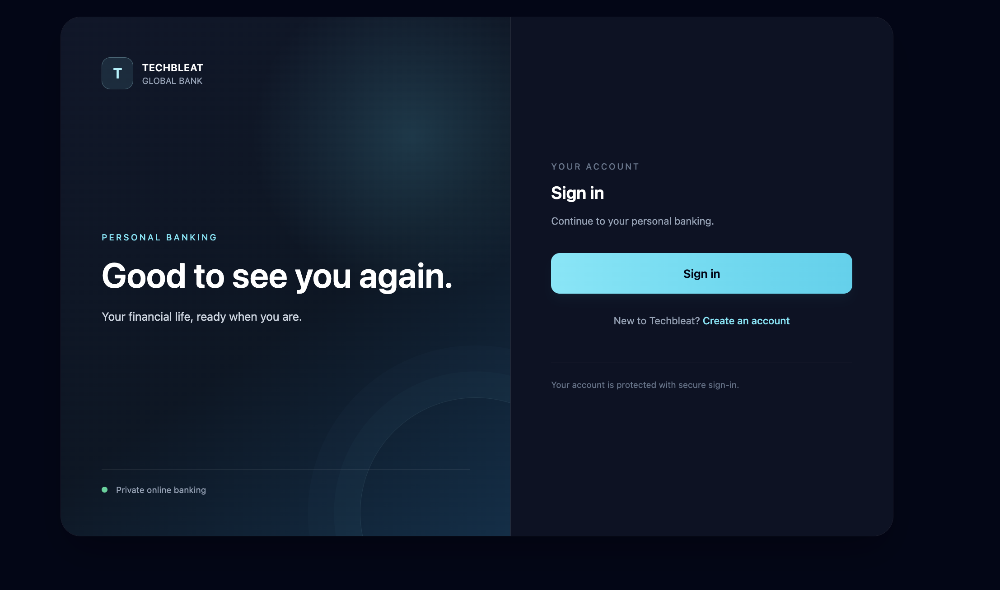
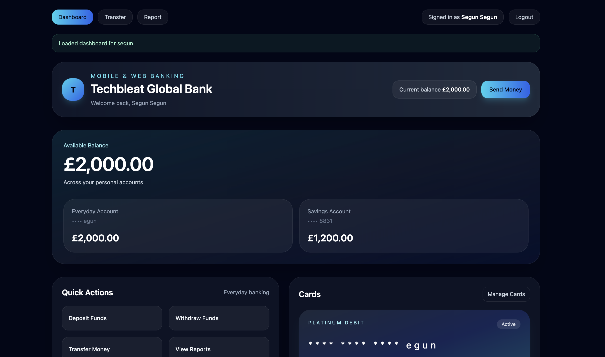

# Techbleat Global Bank

A proof-of-concept digital banking platform with a React customer experience and backend services for customer profiles, accounts, transactions, and activity history.

## Project Layout

- `techbleat-global-bank-frontend/` — React/Vite sign-in, registration, dashboard, transfers, and reports.
- `techbleat-global-bank-backend/` — FastAPI user and activity services, Spring Boot transaction service, database setup, and Docker Compose configuration.
- [`docs/architecture.md`](./docs/architecture.md) — target architecture for Cloudflare, Backstage, Kubernetes/Istio, and Datadog.

## Visual Overview

The customer experience uses a deep slate background, cyan highlights, restrained gradients, and high-contrast typography. Sign-in is focused; the dashboard groups account balances, quick actions, and recent activity for scanning.

### Sign In



### Banking Dashboard



## Prerequisites

- Docker with Docker Compose v2.24 or newer
- Node.js 18 or newer if running the frontend outside Docker
- Keycloak running in the `banking` realm

## Run with Docker Compose

From the repository root:

```sh
cd techbleat-global-bank-backend
docker compose up --build
```

The frontend is served at `http://localhost:3000`. Before starting Compose, configure `POSTGRES_PASSWORD` in an untracked `techbleat-global-bank-backend/.env` file; Compose uses it for PostgreSQL and all database-backed services. Keep it the same as the password already configured in an existing local database volume. Before using registration, also configure `KEYCLOAK_ADMIN_CLIENT_SECRET` in that file. The Keycloak URL defaults to `http://host.docker.internal:8080` for Docker Desktop. For example, add these entries to the file:

```dotenv
POSTGRES_PASSWORD=your-local-database-password
KEYCLOAK_ADMIN_CLIENT_SECRET=your-keycloak-client-secret
```

The FinanceAgent is served at `http://localhost:9001`; signed-in customers with the `banking-ai-agent` role can open it from the **AI Assistant** button in the frontend. The frontend proxies agent requests through its web origin. To enable chat, copy `finance-agent/.env.example` to `finance-agent/.env` and set `OPENAI_API_KEY`; the agent container loads that file when present. The file is excluded from the container image. Configure the Keycloak audience for authenticated agent requests, as described in the agent README.

Check service health at:

- User service: `http://localhost:8000/health`
- Transaction service: `http://localhost:8090/health`
- Activity service: `http://localhost:8001/health`
- FinanceAgent: `http://localhost:9001/health`

## Run the Frontend Separately

Start the backend services first, then run:

```sh
cd techbleat-global-bank-frontend
npm ci
npm run dev
```

Vite serves the frontend at `http://localhost:3000` and proxies `/user-api`, `/transaction-api`, and `/activity-api` to the backend services. If Keycloak uses port `8080`, the transaction service is exposed on host port `8090` to avoid a port conflict.

## Keycloak Configuration

The `banking` realm is defined in [`keycloak/banking-realm.json`](./keycloak/banking-realm.json) and applied with a script that is safe to rerun. It needs only Python 3.9+ and prompts for the Keycloak admin password:

```sh
python keycloak/configure_realm.py --dry-run
python keycloak/configure_realm.py --env-file techbleat-global-bank-backend/.env
```

The second command writes the `banking-provisioner` client secret into the git-ignored backend `.env` without printing it. Set `KEYCLOAK_URL` if Keycloak is not at `http://localhost:8080`; for a deployed environment set `FRONTEND_URL=https://<your-domain>` and `KEYCLOAK_SSL_REQUIRED=all`. See [`keycloak/README.md`](./keycloak/README.md) for what the script configures.

In summary:

- `banking-frontend`: public client using Authorization Code with PKCE (`S256`) only; redirect URI, web origin, and post-logout URI are the exact `FRONTEND_URL`. Its access tokens carry the `banking-api` audience and only the three banking realm roles.
- `banking-provisioner`: confidential client whose service account holds only `realm-management` → `manage-users`. Keep its secret in the backend environment only; never put it in frontend variables.
- Realm: 12-character password policy, brute-force lockout, 5-minute access tokens, and **Edit username** off. The APIs identify the bank account by the token's `preferred_username`, so users must not be able to change it.

The app registration form collects a user ID, name, email, and password. The user service provisions the Keycloak identity, bank profile, and zero-balance account. The initial password is temporary, so Keycloak requires a password change at first sign-in. User IDs are stored in lowercase to match Keycloak usernames. Passwords must be at least 12 characters; Keycloak realm password policy may impose additional requirements.

An administrator must assign `banking-customer` after registration before the user can access banking. `banking-transact` additionally enables deposits, withdrawals, and transfers. Assign `banking-ai-agent` to users who should see and use the AI Assistant. Assign them as realm roles. The transaction service enforces `banking-customer` (read) and `banking-transact` (write) server-side. The `banking-ai-agent` role currently gates the frontend UI only; the FinanceAgent API still relies on token validation and has no role check.

## API Overview

| Service | Base URL | Main endpoints |
| --- | --- | --- |
| User | `http://localhost:8000` | `GET /health`, `GET /users/me`, `POST /users` |
| Transaction | `http://localhost:8090` | `GET /health`, `GET /balance/{userId}`, `GET /transactions/{userId}`, `POST /transactions/deposit`, `POST /transactions/withdraw`, `POST /transactions/transfer` |
| Activity | `http://localhost:8001` | `GET /health`, `GET /activities/{userId}` |

Registration uses `POST /users` with `id`, `full_name`, `email`, and `password`, and is the only unauthenticated endpoint besides `/health`. All other endpoints require a bearer token with the `banking-api` audience and the `banking-customer` role; transaction writes also require `banking-transact`. Each API acts on the token's `preferred_username`: `GET /users/me` returns only the caller's profile, and a `{userId}` path value or `X-User-Id` header that names a different user is rejected with `403`.

## Security Notes

- This is a proof of concept. The user, transaction, and activity services validate bearer-token signature, issuer, audience, expiry, roles, and account ownership; authentication failures and denials are logged under `security.audit` without the token. Frontend role checks are not server-side authorization.
- Email verification and signup rate limiting are not currently implemented.
- Run the security tests with `mvn test` in `transaction-service`, and with `pip install -r requirements.txt -r requirements-dev.txt && python -m pytest tests` in `user-service` and `activity-service`.
- Never commit `.env` files, Keycloak client secrets, or secret manifests.
